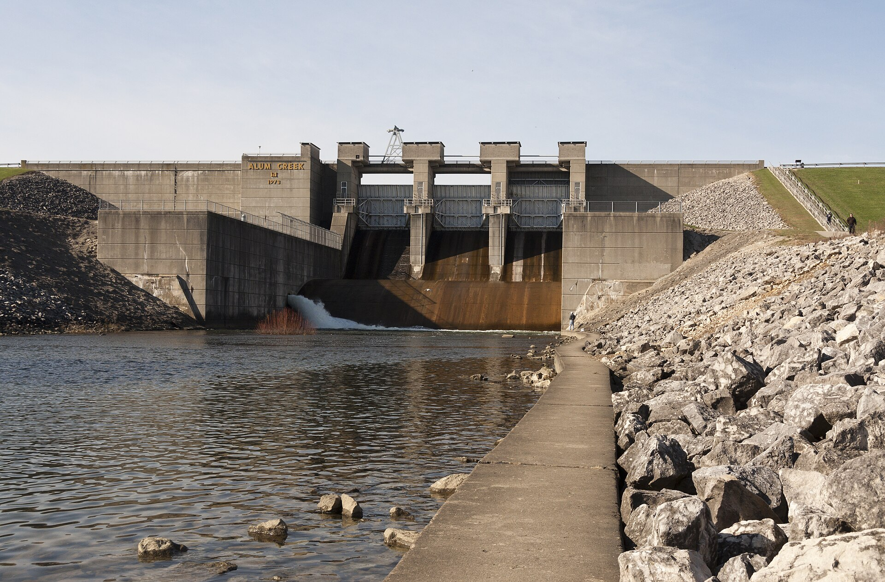
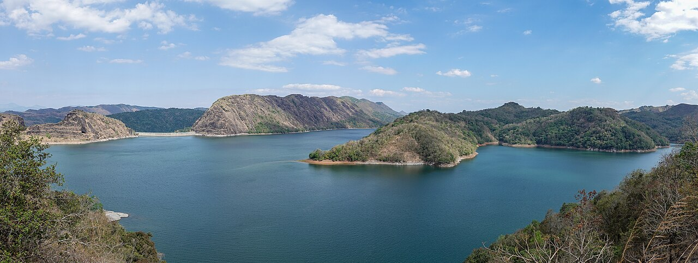
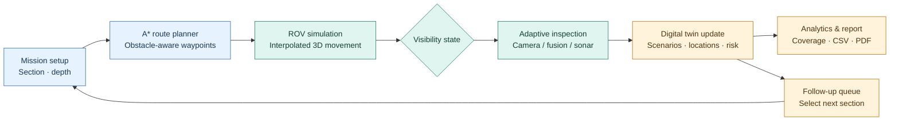
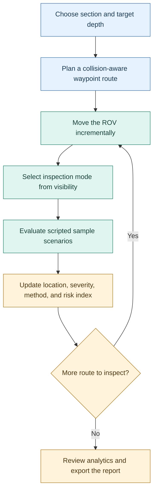
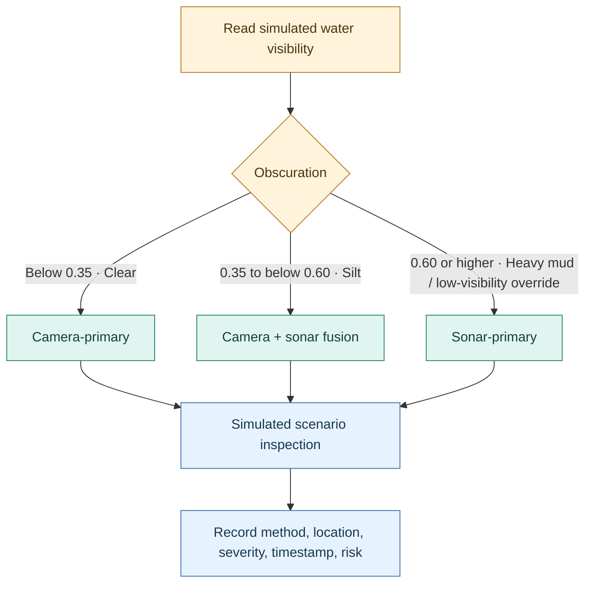
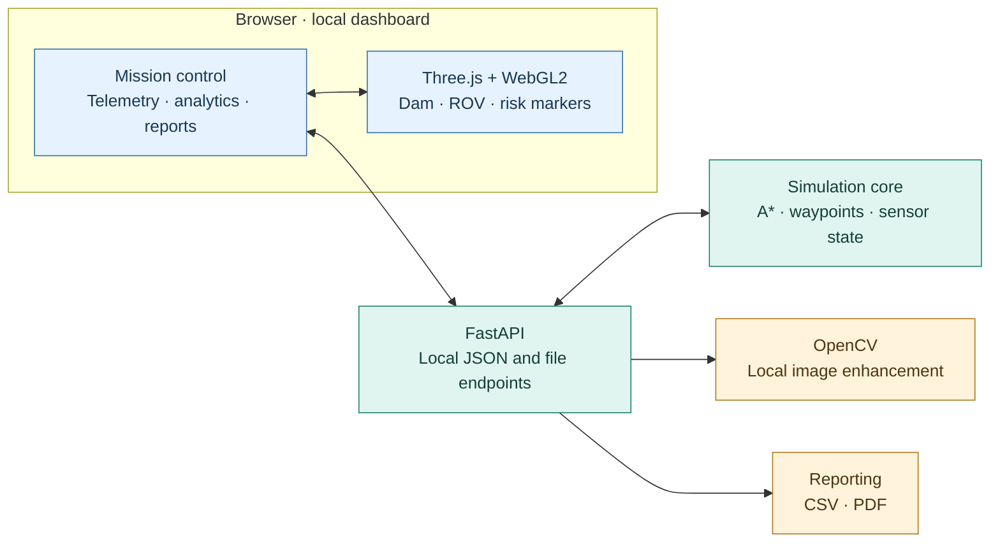

# AQUAINSPECT 3D

### Adaptive underwater inspection. A risk-aware digital twin. A clear view of the mission.

AQUAINSPECT 3D is an **offline-first dam inspection simulator**. A local Python service plans an obstacle-aware ROV mission, while a Three.js/WebGL2 dashboard visualizes the vehicle, dam wall, inspection route, synthetic sensor returns, and defect scenarios.

The inspection mode adapts to simulated water visibility: camera in clear water, camera/sonar fusion in silt, and sonar-primary in heavy mud or low visibility. Findings feed a risk-ranked section queue so operators can explore what to inspect next.

> **Simulation boundary:** This project does not control a physical ROV. Camera/video, sonar returns, water conditions, communications, defect detections, and risk scores are simulated. The risk index is a demonstration triage aid—not an engineering assessment or a probability-of-failure estimate.

**▶ Run locally:** follow [Installation](#installation)<br />
**🧭 Explore the workflow:** [Mission flow](#mission-flow) · [Adaptive imaging](#adaptive-imaging-flow) · [Risk prioritization](#risk-prioritization)<br />
**📄 Reports:** [CSV and PDF exports](#inspection-reports)


---

## At a glance

| | |
|---|---|
| **Purpose** | Demonstrate an autonomous dam-inspection ROV and land-station workflow |
| **Core loop** | Configure → plan → navigate → adapt imaging → record findings → prioritize → report |
| **3D scene** | Procedural dam wall, terrain, obstacles, inspection markers, and assembled ROV |
| **Adaptive sensors** | Camera-primary / camera + sonar fusion / sonar-primary, selected from visibility |
| **Digital twin** | Scenario map with severity/type-weighted risk indices and follow-up section queue |
| **Dashboard** | Three.js, WebGL2, JavaScript, responsive dark/light themes |
| **Local service** | FastAPI simulation, NumPy navigation, OpenCV enhancement, CSV/PDF reports |
| **Data mode** | Synthetic telemetry and detections; core demonstration runs locally without API keys |

## Contents

1. [Five-minute showcase](#five-minute-showcase)
2. [Visual reference](#visual-reference)
3. [Mission flow](#mission-flow)
4. [Adaptive imaging flow](#adaptive-imaging-flow)
5. [Risk prioritization](#risk-prioritization)
6. [System architecture](#system-architecture)
7. [Dashboard capabilities](#dashboard-capabilities)
8. [Installation](#installation)
9. [Operating the simulator](#operating-the-simulator)
10. [Inspection reports](#inspection-reports)
11. [Repository layout](#repository-layout)
12. [Simulation limits](#simulation-limits)
13. [Tests and photo credits](#tests-and-photo-credits)

---

## Five-minute showcase

Use this path to demonstrate the core story without presenting simulated results as field data:

| Step | What to show | What it demonstrates |
|---|---|---|
| **1 · Open the dashboard** | Launch the app and point out the 3D dam and assembled ROV. | A local land-station view of a procedural digital twin. |
| **2 · Change visibility** | Select **Silt**, then **Heavy mud**, and watch the imaging badge and telemetry update. | Automatic camera → fusion → sonar-primary handoff. |
| **3 · Configure a route** | Choose a dam section and inspection depth; start the inspection. | Waypoint planning, interpolated motion, and simulated obstacle avoidance. |
| **4 · Explore the map** | Toggle **Risk Map** and click a wall marker. | Risk score and location for an unscanned scenario or a recorded simulated finding. |
| **5 · Plan a follow-up** | Choose a section from the risk queue. | A prioritized section is selected for the next mission. |
| **6 · Review the outcome** | Open Data Analytics or Inspection Report; download CSV/PDF. | Coverage, scenario findings, telemetry, risk triage, and report export. |

---

## Visual reference

The project includes locally bundled dam photographs for **real-world context only**. They are not images from the ROV, inspection scans, or evidence of structural condition.

| | |
|:--:|:--:|
|  |  |
| **Alum Creek Dam spillway** · Ohio, USA | **Idukki Dam reservoir** · Kerala, India |

The main dashboard scene itself is generated procedurally in Three.js: a curved concrete face with structural details, underwater terrain, suspended particles, obstacles, and inspection overlays.

---

## Mission flow

The mission lifecycle connects the land-based controls to the simulated vehicle and final report:



### One inspection pass



---

## Adaptive imaging flow

Visibility selects the **primary simulated inspection method**. The sonar display and synthetic obstacle returns remain available in every mode.



| Water setting | Obscuration used by the simulation | Primary mode |
|---|---:|---|
| **Clear** | 0.08 | Camera |
| **Silt** | 0.42 | Camera + sonar fusion |
| **Heavy mud** | 0.78 | Sonar |
| **Low-visibility override** | At least 0.60 | Sonar |

The simulated camera preview visibly degrades as obscuration rises. Detection records state which simulated inspection method was active; they are not machine-learning predictions or physical sensor readings.

---

## Risk prioritization

The digital twin maps scripted scenarios onto the dam wall. A marker can be selected in the 3D scene to review its type, coordinates, severity, and risk index. A section queue ranks the next mission candidates and can preselect a section in Mission Control.

### Demonstration scoring model

1. Start with a severity weight: **High 72**, **Medium 48**, or **Low 24**.
2. Add a defect-type weight: **Leakage +14**, **Crack +10**, **Erosion +6**, or **Surface damage +4**.
3. Cap the scenario score at **100**.
4. A section score starts at its highest-risk scenario score, adds **5** for each recorded scenario finding in that section, and is also capped at **100**.
5. Sort sections by score, highest first.

| Dam section | X-coordinate grouping |
|---|---|
| **Left** | X < −6 m |
| **Center** | −6 m ≤ X < 6 m |
| **Right** | X ≥ 6 m |

This fixed, transparent weighting exists to demonstrate triage and mission planning. It is not validated against structural engineering data, calibrated failure probabilities, or inspections of a real dam.

---

## System architecture



The browser renders the scene locally. FastAPI serves the dashboard and provides simulation, image-processing, and report endpoints. After dependencies and the bundled frontend are installed, the demo does not need an external AI service, API key, or 3D asset download.

---

## Dashboard capabilities

| Area | What it does |
|---|---|
| **3D mission view** | Orbit, pan, and zoom around a procedural dam, assembled ROV, route, traveled path, sonar sweep, obstacles, and risk map. |
| **Mission control** | Select an inspection section and depth; start, pause, resume, return to surface, or reset. |
| **Manual movement** | Move left/right, up/down, and toward/away from the wall. Moves are interpolated and obstacle-aware. |
| **Adaptive imaging** | Switches camera/sonar modes with visibility; keeps sonar obstacle returns available in low visibility. |
| **Sonar alerts** | Shows synthetic returns and a blinking obstacle indicator; optional browser-generated alert sound can be muted. |
| **Live video preview** | Procedural camera imagery only. Optional OpenCV enhancement runs locally on the generated frame. |
| **Communications** | Illustrates tethered and acoustic link states, packets, and interruption/recovery events; does not model real link guarantees. |
| **Digital-twin analytics** | Shows section risk ranking, scenario locations, mission coverage, finding severity, and telemetry. |
| **Themes** | Dark and light modes; the selected theme is persisted in browser storage. |
| **Inspection reports** | Download a CSV data summary or a PDF mission report with risk-ranked follow-up sections. |

---

## Installation

### Requirements

- Python 3.10 or later
- Node.js 18 or later
- A modern browser with WebGL2 support

### Windows · PowerShell

From the repository folder:

```powershell
python -m venv .venv
.\.venv\Scripts\Activate.ps1
python -m pip install -r requirements.txt
npm install
npm run build
python -m uvicorn app:app --reload
```

Open [http://127.0.0.1:8000](http://127.0.0.1:8000). Stop the server with **Ctrl+C**.

If PowerShell blocks virtual-environment activation, install with `.\.venv\Scripts\python.exe -m pip install -r requirements.txt` and run with `.\.venv\Scripts\python.exe -m uvicorn app:app --reload`.

The frontend bundle is committed at `static/assets/app.js`; rebuild it after changing `web/src/main.js`:

```powershell
npm run build
```

---

## Operating the simulator

### Mission control

1. Choose **Full Dam Survey**, **Left Section**, **Center Section**, or **Right Section**.
2. Set the target inspection depth.
3. Select a water condition and optional low-visibility override.
4. Start the mission and follow the route in the 3D view.
5. Pause/resume, return to the surface, or reset using the control buttons.

### Manual ROV controls

| Control | Action |
|---|---|
| **← / →** or keyboard arrow keys | Move horizontally |
| **↑ / ↓** or keyboard arrow keys | Change depth |
| **Toward / Away** or **W / S** | Change distance from the dam wall |
| **Zoom + / −** | Zoom the 3D camera |
| **Focus ROV / Reset camera** | Center on the vehicle / restore the default view |

Manual movement is simulated, interpolated, and rejected if it would collide with a modeled obstacle or leave navigation bounds.

---

## Inspection reports

The dashboard offers **Download CSV** and **Download PDF report**. Reports include:

- Mission status, selected sections, inspection depth, coverage, route distance, and robot telemetry.
- Recorded simulated findings with location, severity, risk score, detection method, and timestamp.
- Synthetic sonar obstacle returns in range.
- Adaptive imaging mode and water condition.
- Risk-ranked follow-up sections and the reason for each recommendation.

The PDF also includes the project’s credited dam reference photographs, clearly identified as visual context and not scan footage.

---

## Repository layout

| Path | Responsibility |
|---|---|
| `app.py` | FastAPI app, state/settings API, image endpoints, and report downloads |
| `simulation.py` | ROV state, A* navigation, visibility handoff, scenarios, and risk ranking |
| `vision.py` | OpenCV enhancement profiles, generated sample images, and image heuristics |
| `reporting.py` | CSV/PDF report generation |
| `web/src/main.js` | Three.js scene, browser controls, telemetry, charts, and interactions |
| `static/index.html` | Dashboard structure |
| `static/styles.css` | Responsive layout, theme styles, and risk-map presentation |
| `static/assets/app.js` | Bundled Three.js and Chart.js frontend |
| `static/images/` | Locally bundled dam reference photographs |
| `tests/test_simulation.py` | Navigation, adaptive imaging, risk ranking, image processing, and report tests |

---

## Simulation limits

- The ROV, dam geometry, sensor behavior, route, findings, and defect coordinates are demonstration data—not field measurements.
- The video panel is a procedural preview; there is no connected underwater camera.
- Sonar is simulated visualization and does not perform acoustic ranging.
- Tethered/acoustic communication quality, bandwidth, and interruption behavior are illustrative only.
- OpenCV enhancements alter the appearance of an image but cannot recover detail that was never captured.
- Image candidate regions use heuristics; they are not verified defects or trained-model predictions.
- Risk indices and follow-up recommendations are not structural health assessments. Have qualified engineers interpret real inspection data.

## Tests and photo credits

Run the test suite from the repository root:

```powershell
python -m unittest discover -s tests -v
```

The bundled dam photographs are included for visual context:

- **Alum Creek Dam spillway**, Ohio — Sixflashphoto, [CC BY-SA 4.0](https://creativecommons.org/licenses/by-sa/4.0/), [Wikimedia Commons source](https://commons.wikimedia.org/wiki/File:Alum_Creek_Dam_Spillway_1.jpg).
- **Idukki Dam reservoir panorama**, Kerala — Timothy A. Gonsalves (Tagooty), [CC BY-SA 4.0](https://creativecommons.org/licenses/by-sa/4.0/), [Wikimedia Commons source](https://commons.wikimedia.org/wiki/File:Idukki_Dam_Reservoir_Hillview_Pano_Kerala_Mar22_R16_05581-Pano.jpg).
